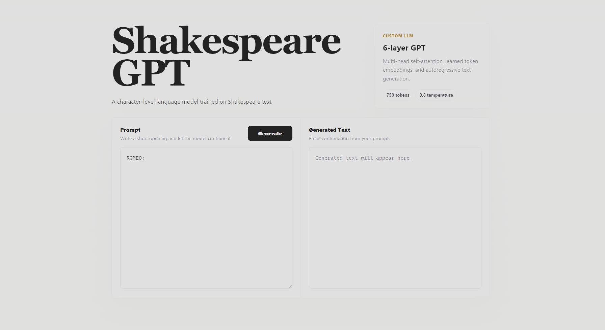
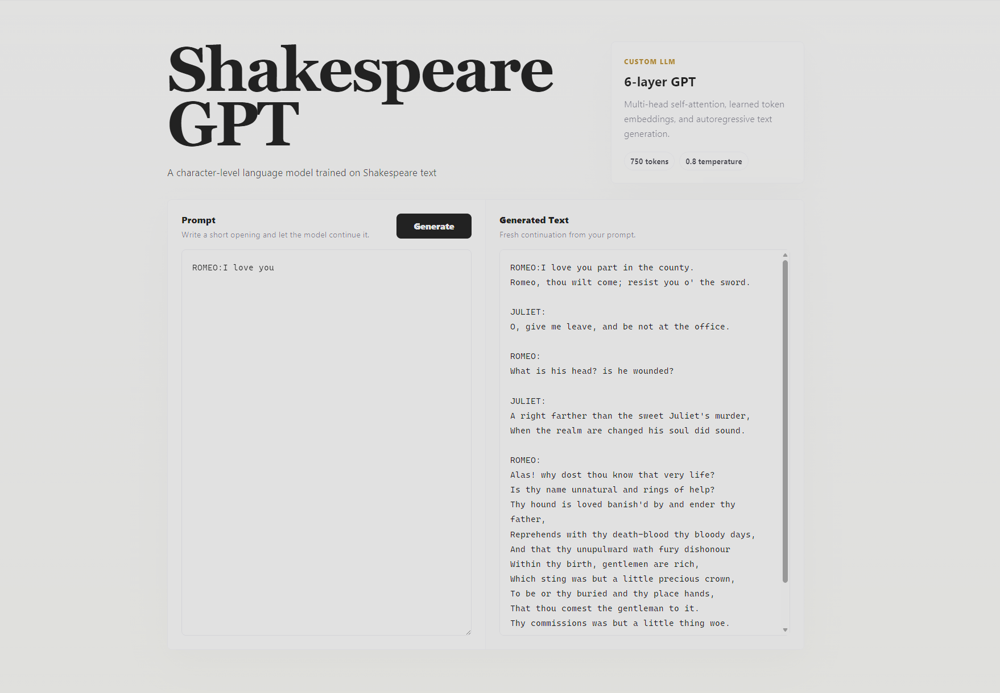

# ShakespeareGPT: GPT-Style Language Model with Web UI



A GPT-style decoder-only language model implemented and trained from scratch in PyTorch on a character-level Shakespeare text corpus. The trained model is also available through a lightweight Flask browser interface for interactive text generation.

## Project overview

The core of this project is a decoder-only Transformer built to study character tokenization, positional embeddings, causal multi-head attention, Transformer blocks, and autoregressive generation. The browser interface was added later with Codex and Antigravity; the from-scratch model and training work are distinct from that application integration.

Enter a prompt in the web interface to generate Shakespeare-style text with the trained checkpoint.



## Model architecture

The model uses learned token and positional embeddings, causal multi-head self-attention, pre-normalized Transformer blocks, residual connections, a feed-forward network, and a final language-modeling head. It predicts the next character from the preceding context. The attention operation uses PyTorch's `nn.MultiheadAttention`; no pretrained Transformer weights are used.

| Property | Value |
| --- | ---: |
| Transformer blocks | 6 |
| Attention heads | 6 |
| Embedding dimension | 384 |
| Maximum context | 256 characters |
| Vocabulary | 65 characters |
| Dropout | 0.1 |
| Trainable parameters | 8,134,721 |

The architecture is defined in [model.py](model.py). The parameter count was checked against the saved checkpoint.

## Training data

[dataset.py](dataset.py) downloads a [Shakespeare text corpus](https://github.com/atilsamancioglu/ShakespeareInput/blob/main/input.txt). The local training copy contains **1,115,394 characters** and has SHA-256 `86c4e6aa9db7c042ec79f339dcb96d42b0075e16b8fc2e86bf0ca57e2dc565ed`. The source is a single text file; this project does not establish that it contains Shakespeare's complete works.

The code builds a character vocabulary and splits token IDs **in order**: the first 90% (1,003,854 characters) for training and the final 10% (111,540 characters) for held-out evaluation. It does not shuffle or split by play.

## Training configuration

The original training loop is included as [train.py](train.py); it works with this repository's [dataset.py](dataset.py) and [model.py](model.py).

| Setting | Recorded value |
| --- | ---: |
| Optimizer | AdamW |
| Learning rate | 3 × 10⁻⁴ after a 100-iteration linear warmup |
| Batch size | 64 sequences |
| Training iterations | 5,000 |
| Gradient clipping | Norm 1.0 |
| Evaluation | Every 500 iterations and at the final iteration |
| Evaluation sampling | Mean loss over 100 random batches per split |
| Device | CUDA when available, otherwise CPU |

No random seed is set in the original training script. The corpus URL points to a branch rather than an immutable revision, so a fresh download may differ from the recorded training copy.

## Evaluation result

The included [model.pt](model.pt) is the **final 5,000-iteration checkpoint** from the original training project; the two files have matching SHA-256 hashes. Its metadata records a held-out **test loss of 2.086024811267853** (reported as **2.086**). This is mean next-character cross-entropy over 100 randomly sampled batches from the final 10% of the same corpus. It is not a result on an independent Shakespeare collection.

Checkpoint SHA-256: `c88dfde6690d9743745071ecc5ef10378551c821ebe0e1216d9afe3403e27677`.

## Repository structure

```text
ShakespeareGPT_Scratch_With_UI/
├── app.py              # Flask browser application
├── dataset.py          # Corpus loading, split, and character tokenizer
├── inference.py        # Text generation pipeline
├── model.py            # GPT architecture
├── model.pt            # Included final training checkpoint
├── train.py            # Original model training loop
├── paths.py            # Project path configuration
├── requirements.txt    # Python dependencies
├── templates/          # Browser page
├── static/             # CSS and JavaScript
├── docs/assets/        # README screenshots
└── README.md
```

The Flask application uses the included checkpoint for generation. Its browser layer is separate from the model training described above.

## Technologies and features

The model and training code use Python, PyTorch, and CUDA when available. The browser interface uses Flask, HTML, CSS, and JavaScript. Together, the repository includes character-level tokenization, multi-head self-attention, learned positional embeddings, checkpointed training, temperature-controlled autoregressive generation, and browser-based prompt input.

## Reproduce training

From the repository root, install the Python dependencies and run:

```bash
python -m pip install -r requirements.txt
python train.py
```

If `data/shakespeare.txt` is absent, the script downloads the corpus. It writes a newly trained checkpoint to `checkpoints/model.pt`; the included `model.pt` remains untouched. Compare the downloaded corpus SHA-256 with the value above before comparing metrics. Because the script does not fix random seeds or package versions, an exact loss match is not guaranteed.
